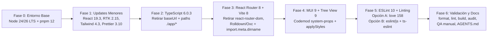

# Plan y Bitácora Versionada de Migración Tecnológica (`sbcclient`)

> **Propósito**: Este documento centraliza y versiona por fecha (`YYYY-MM-DD`) las auditorías de dependencias, análisis de _breaking changes_, bloqueadores de compatibilidad y hojas de ruta de actualización tecnológica de **`sbcclient`**.
>
> **Regla de uso**: Cada nuevo ciclo de actualización debe agregarse **al inicio** (orden cronológico inverso, la fecha más reciente primero) usando la convención `## [YYYY-MM-DD] — <Título>`, actualizar el **Índice Histórico** y marcar el estado correspondiente (`Planificado`, `En progreso`, `Parcial / Bloqueado`, `Completado`).

---

## Convención de Versionado para Futuras Actualizaciones

Para registrar un nuevo ciclo en este mismo archivo:

1. Agrega una fila al inicio de la tabla **Índice Histórico de Ciclos de Migración**.
2. Crea una nueva sección `## [YYYY-MM-DD] — <Descripción breve>` encima de las entradas previas.
3. Incluye mínimamente: **Metadatos del ciclo**, **Inventario de versiones** (declarada, instalada y última estable), **Bloqueadores y matriz de compatibilidad**, **Breaking changes e impacto en archivos**, **Auditoría de seguridad (`pnpm audit`)**, **Plan por fases** y **Checklist de verificación**.
4. Cuando se ejecute una migración planificada, actualiza su estado (`Planificado` → `Completado`), registra la fecha real de ejecución y sincroniza `AGENTS.md`, `.agents/skills/*`, `docs/agent-guidelines-en/*` y `docs/TECHNICAL_DEBT.md`.

### Índice Histórico de Ciclos de Migración

| Versión (Fecha)  | Estado                                 | Alcance / Resumen                                                                                                                                                                                                                                                                                     | Enlace                                                                                            |
| :--------------- | :------------------------------------- | :---------------------------------------------------------------------------------------------------------------------------------------------------------------------------------------------------------------------------------------------------------------------------------------------------- | :------------------------------------------------------------------------------------------------ |
| **`2026-11-20`** | **Planificado** _(solo documentación)_ | Auditoría integral de 37 paquetes + `Node.js` y `pnpm`. Saltos mayores: `pnpm` 10→12, `React Router` 7→8, `Vite` 7→8, `MUI` 7→9, `MUI X Tree View` 8→9, `TypeScript` 5.9→6.0 (puente hacia 7.0), `ESLint` 9→10, `eslint-config-love` 116→158, `globals` 16→17, `eslint-plugin-react-refresh` 0.4→0.5. | [Ver análisis 2026-11-20](#2026-11-20--auditoría-integral-de-actualización-del-stack-tecnológico) |

---

## [2026-11-20] — Auditoría Integral de Actualización del Stack Tecnológico

### Metadatos del Ciclo

- **Fecha de auditoría**: `2026-11-20`
- **Estado**: `Planificado` _(este registro únicamente documenta el análisis y plan de migración; no se han aplicado cambios a `package.json`, `pnpm-lock.yaml` ni al código fuente)_
- **Entorno local auditado**: `Node.js v22.23.1`, `pnpm 10.29.2` (`packageManager: "pnpm@10.29.2"`), Windows
- **Inventario auditado**: 37 paquetes directos en `package.json` (16 `dependencies` + 21 `devDependencies`) + 2 herramientas base (`Node.js`, `pnpm`) = **39 elementos**
- **Línea base conocida**:
  - `pnpm lint`: **68 errores y 1 advertencia preexistentes** (registrados en [TECHNICAL_DEBT.md](./TECHNICAL_DEBT.md)).
  - `pnpm audit`: **74 vulnerabilidades** (`0 critical`, `43 high`, `27 moderate`, `4 low`) sobre 505 dependencias totales.

---

### 1. Resumen Ejecutivo y Hoja de Ruta por Fases

El análisis del registro de npm al **2026-11-20** revela una brecha importante en varias capas del stack: **10 grupos de actualización mayor** (`pnpm`, `Node.js`, `React Router`, `Vite`, `Material UI`, `MUI X Tree View`, `TypeScript`, `ESLint` + `eslint-config-love` + plugins, `globals` y `@types/node`), además de **bloqueadores de `peerDependencies`** que impiden actualizar todos los paquetes en un solo paso desordenado.

Los tres hallazgos estratégicos que definen el orden de ejecución son:

1. **Bloqueador TypeScript `7.0.2` vs `typescript-eslint@8.73.0`**: `typescript@7.0.2` es el compilador nativo reescrito en Go (_Project Corsa_) y carece aún de la API JS requerida por `typescript-eslint`, cuyo `peerDependencies` limita explícitamente `typescript` a `>=4.8.4 <6.1.0`. **Ruta recomendada**: migrar a **`typescript@~6.0.3`** como versión puente estable y reservar `7.x` para el siguiente ciclo cuando `typescript-eslint` libere soporte nativo (previsto con TS 7.1+).
2. **Incompatibilidad en cadena en ESLint 10**: `eslint-config-love@158.0.0` exige `eslint@^10.0.0` y **eliminó `eslint-plugin-import`** (cuyo límite máximo es `eslint@^9`), rompiendo la regla `'import/no-absolute-path': 'off'` en `eslint.config.js`. Además implica un salto de 42 versiones mayores sobre 68 errores previos de lint.
3. **Eliminación de _system props_ directos en MUI v9 y de `react-router-dom` en React Router v8**: El escaneo estático de `app/` identificó **25 usos críticos de _system props_** en `<Stack>` y `<Typography>` (más 4 usos de `color` con paths de tema) que deben moverse a `sx`, y 1 importación de `react-router-dom` en `app/root.tsx:3` que debe migrar a `react-router`.



---

### 2. Inventario Completo de Versiones (`2026-11-20`)

#### 2.1 Runtime y Gestor de Paquetes (2)

| Herramienta | Declarado         | Instalado Local                                | Última / LTS (`2026-11-20`)                                                                               | Tipo de Cambio                  | Nivel de Riesgo | Acción Recomendada                                                                                                                                |
| :---------- | :---------------- | :--------------------------------------------- | :-------------------------------------------------------------------------------------------------------- | :------------------------------ | :-------------- | :------------------------------------------------------------------------------------------------------------------------------------------------ |
| **Node.js** | _(sin `engines`)_ | `v22.23.1` _(Maintenance LTS, EOL 2027-04-30)_ | `v24.x` _(Maintenance LTS, EOL 2028-04-30)_ / **`v26.x`** _(Active LTS desde 2026-10-28, EOL 2029-04-30)_ | **Major (22 → 24/26)**          | Medio           | Actualizar a **Node 24 LTS o 26 Active LTS** (mínimo estricto del stack objetivo: `>=22.22.0`). Declarar `engines.node` en `package.json`.        |
| **pnpm**    | `pnpm@10.29.2`    | `10.29.2`                                      | **`12.21.0`** _(v10: `10.34.9`, v11: `11.28.12`)_                                                         | **Major (+2: v10 → v11 → v12)** | Medio           | Migrar a `pnpm@12.21.0` (motor Rust) aplicando reglas de v11 (`pnpm-workspace.yaml`, `allowBuilds`, `minimumReleaseAge`) y v12 (flags estrictos). |

#### 2.2 Dependencias de Producción — `dependencies` (16)

| Paquete               | Declarado (`package.json`) | Instalado (`node_modules`) | Última (`latest`)                      | Tipo de Cambio        | Riesgo / Impacto | Acción Recomendada                                                                                                                       |
| :-------------------- | :------------------------- | :------------------------- | :------------------------------------- | :-------------------- | :--------------- | :--------------------------------------------------------------------------------------------------------------------------------------- |
| `react`               | `^19.2.0`                  | `19.2.4`                   | **`19.3.1`**                           | Minor                 | Bajo             | Actualizar a `^19.3.1` (**prerrequisito obligatorio**: React Router 8 exige `>=19.2.7`).                                                 |
| `react-dom`           | `^19.2.0`                  | `19.2.4`                   | **`19.3.1`**                           | Minor                 | Bajo             | Actualizar junto con `react` a `^19.3.1`.                                                                                                |
| `react-router`        | `^7.13.1`                  | `7.13.1`                   | **`8.5.2`** _(v7: `7.18.6`)_           | **Major (v7 → v8)**   | Alto             | Actualizar a `^8.5.2`. ESM-only, exige Node `>=22.22.0`, React `>=19.2.7`, Vite `^7 \|\| ^8`. Resuelve 12 advisories.                    |
| `react-router-dom`    | `^7.13.1`                  | `7.13.1`                   | `7.18.6` _(sin v8)_                    | **Eliminación**       | Medio            | **Desinstalar**. Reemplazar `import type { LinksFunction } from 'react-router-dom'` en `app/root.tsx:3` por `'react-router'`.            |
| `@react-router/node`  | `^7.13.1`                  | `7.13.1`                   | **`8.5.2`** _(v7: `7.18.6`)_           | **Major (v7 → v8)**   | Bajo-Medio       | Actualizar a `^8.5.2` (o validar retiro como dependencia directa en SPA `ssr: false`, ya que `@react-router/dev@8.5.2` la incluye).      |
| `isbot`               | `^5`                       | `5.1.35`                   | **`5.2.3`**                            | Minor / Limpieza      | Bajo             | **Evaluar desinstalación** en SPA (`ssr: false` sin `entry.server.tsx`; no se importa en `app/`). Si se conserva, actualizar a `^5.2.3`. |
| `@mui/material`       | `^7.3.9`                   | `7.3.9`                    | **`9.5.0`** _(v7: `7.3.11`, saltó v8)_ | **Major (v7 → v9)**   | Alto             | Actualizar a `^9.5.0`. Ejecutar codemod `v9.0.0/system-props`, migrar `theme.palette.mode` a `applyStyles` y validar `Tabs`/teclado.     |
| `@mui/icons-material` | `^7.3.9`                   | `7.3.9`                    | **`9.5.0`** _(v7: `7.3.11`)_           | **Major (v7 → v9)**   | Bajo             | Actualizar a `^9.5.0` junto con `@mui/material` (`peerDep: ^9.5.0`).                                                                     |
| `@mui/x-tree-view`    | `^8.27.2`                  | `8.27.2`                   | **`9.18.0`** _(v8: `8.29.3`)_          | **Major (v8 → v9)**   | Bajo             | Actualizar a `^9.18.0`. Compatible con `@mui/material ^7.3.0 \|\| ^9.0.0`; `Accounts.tsx` no usa APIs eliminadas.                        |
| `@emotion/react`      | `^11.14.0`                 | `11.14.0`                  | `11.14.0`                              | Al día                | Nulo             | Mantener en `^11.14.0` (compatible con React 19 y MUI v9).                                                                               |
| `@emotion/styled`     | `^11.14.1`                 | `11.14.1`                  | `11.14.1`                              | Al día                | Nulo             | Mantener en `^11.14.1` (compatible con React 19 y MUI v9).                                                                               |
| `@fontsource/roboto`  | `^5.2.10`                  | `5.2.10`                   | **`5.3.0`**                            | Minor                 | Nulo             | Actualizar a `^5.3.0` (sin cambios en rutas `300/400/500/700.css`).                                                                      |
| `@reduxjs/toolkit`    | `^2.11.2`                  | `2.11.2`                   | **`2.15.0`**                           | Minor                 | Bajo             | Actualizar a `^2.15.0`. Revisar manejo de `AbortError` en `.unwrap()` si se limpian entradas de caché activas.                           |
| `react-redux`         | `^9.2.0`                   | `9.2.0`                    | **`9.3.1`**                            | Minor                 | Nulo             | Actualizar a `^9.3.1` (solo depreca `connect`, no usado en el proyecto).                                                                 |
| `formik`              | `^2.4.9`                   | `2.4.9`                    | `2.4.9` _(next: `3.0.0-next.8`)_       | Al día _(vigilancia)_ | Bajo-Medio       | Mantener en `^2.4.9`. Última versión estable en nov 2025; arrastra 2 advisories vía `lodash-es` (ver sección de seguridad).              |
| `yup`                 | `^1.7.1`                   | `1.7.1`                    | `1.7.1`                                | Al día                | Nulo             | Mantener en `^1.7.1`.                                                                                                                    |

#### 2.3 Dependencias de Desarrollo — `devDependencies` (21)

| Paquete                       | Declarado (`package.json`) | Instalado (`node_modules`) | Última (`latest`)                       | Tipo de Cambio              | Riesgo / Impacto         | Acción Recomendada                                                                                                                                                                                                   |
| :---------------------------- | :------------------------- | :------------------------- | :-------------------------------------- | :-------------------------- | :----------------------- | :------------------------------------------------------------------------------------------------------------------------------------------------------------------------------------------------------------------- |
| `@react-router/dev`           | `^7.13.1`                  | `7.13.1`                   | **`8.5.2`** _(v7: `7.18.6`)_            | **Major (v7 → v8)**         | Alto                     | Actualizar a `^8.5.2` junto con `react-router`. Soporta Vite `^7 \|\| ^8` y TS `^5.1 \|\| ^6 \|\| ^7`. Resuelve 10 advisories.                                                                                       |
| `vite`                        | `^7.3.1`                   | `7.3.1`                    | **`8.3.8`**                             | **Major (v7 → v8)**         | Alto                     | Actualizar a `^8.3.8` (motor Rolldown + Oxc + Lightning CSS). Validar build con `rolldown-vite@7` si es necesario y usar `import.meta.dirname`. Resuelve 19 advisories.                                              |
| `@vitejs/plugin-react`        | `^5.1.1`                   | `5.1.4`                    | **`6.3.0`** _(exige `vite@^8`)_         | **Major / Limpieza**        | Bajo                     | **Desinstalar**. No se importa en `vite.config.ts` (JSX y Fast Refresh los gestiona `@react-router/dev/vite`).                                                                                                       |
| `tailwindcss`                 | `^4.2.1`                   | `4.2.1`                    | **`4.3.5`**                             | Minor                       | Nulo                     | Actualizar a `^4.3.5`. Sin breaking changes; solo depreca `start-*`/`end-*` (no usados en `app/`).                                                                                                                   |
| `@tailwindcss/vite`           | `^4.2.1`                   | `4.2.1`                    | **`4.3.5`**                             | Minor                       | Nulo                     | Actualizar a `^4.3.5`. Compatible con `vite@^8`. Resuelve 1 advisory high (`source-map-js`).                                                                                                                         |
| `typescript`                  | `~5.9.3`                   | `5.9.3`                    | **`7.0.2`** _(puente: **`6.0.3`**)_     | **Major (v5.9 → v6 → v7)**  | **Crítico (Bloqueador)** | **Ruta recomendada**: actualizar a **`~6.0.3`** (eliminar `"baseUrl"` en `tsconfig.app.json`) para mantener compatibilidad total con `typescript-eslint@8.73.0`. Diferir `7.x` al siguiente ciclo (ver sección 3.2). |
| `typescript-eslint`           | `^8.48.0`                  | `8.55.0`                   | **`8.73.0`**                            | Minor                       | Medio                    | Actualizar a `^8.73.0`. Soporta ESLint 10, pero limita `typescript <6.1.0`. Migrar `tseslint.config()` a `defineConfig()`.                                                                                           |
| `eslint`                      | `^9.39.1`                  | `9.39.2`                   | **`10.15.0`** _(v9: `9.39.5`)_          | **Major (v9 → v10)**        | Alto                     | Actualizar a `^10.15.0`. Ya usamos Flat Config; revisar `ignores`, lookup por archivo y plugins. Resuelve 18 advisories.                                                                                             |
| `eslint-config-love`          | `^116.0.0`                 | `116.0.0`                  | **`158.0.0`**                           | **Major (+42 majors)**      | Alto                     | Exige `eslint@^10`, elimina `eslint-plugin-import` y añade reglas estrictas. Evaluar **Opción A** (actualizar a `^158.0.0`) vs **Opción B** (migrar a `@eslint/js` + `typescript-eslint`). Resuelve 11 advisories.   |
| `eslint-plugin-import`        | `^2.32.0`                  | `2.32.0`                   | `2.32.0` _(solo `eslint <=9`)_          | **Eliminación obligatoria** | Alto                     | **Desinstalar**. Incompatible con ESLint 10 y ya eliminada de `eslint-config-love@158`. Borrar `'import/no-absolute-path': 'off'` en `eslint.config.js:39`.                                                          |
| `eslint-plugin-n`             | `^17.24.0`                 | `17.24.0`                  | **`18.5.0`**                            | **Major / Limpieza**        | Bajo                     | **Desinstalar si se usa `eslint-config-love@158`** (ya viene como dependencia directa de esta y no se importa en `eslint.config.js`). Si se importa manualmente, actualizar a `^18.5.0` (ESM-only).                  |
| `eslint-plugin-promise`       | `^7.2.1`                   | `7.2.1`                    | **`7.3.0`**                             | Minor / Limpieza            | Bajo                     | **Desinstalar si se usa `eslint-config-love@158`** (dependencia redundante; no se importa en `eslint.config.js`). Si se conserva, `^7.3.0`.                                                                          |
| `eslint-plugin-react-hooks`   | `^7.0.1`                   | `7.0.1`                    | **`7.1.1`**                             | Minor                       | Bajo                     | Actualizar a `^7.1.1`. Soporta ESLint 10, mejora `set-state-in-effect` y ref validation. Resuelve 1 advisory high (`zod`).                                                                                           |
| `eslint-plugin-react-refresh` | `^0.4.24`                  | `0.4.26`                   | **`0.5.8`**                             | **Major (0.4 → 0.5)**       | Medio                    | Actualizar a `^0.5.8`. ESM-only, ESLint `^9 \|\| ^10`, cambiar importación en `eslint.config.js` al export nombrado `reactRefresh`.                                                                                  |
| `eslint-plugin-prettier`      | `^5.5.5`                   | `5.5.5`                    | **`5.5.7`**                             | Patch                       | Nulo                     | Actualizar a `^5.5.7` (compatible con ESLint `>=8` y Prettier `>=3`).                                                                                                                                                |
| `eslint-config-prettier`      | `^10.1.8`                  | `10.1.8`                   | `10.1.8`                                | Al día                      | Nulo                     | Mantener en `^10.1.8` (compatible con ESLint `>=7`).                                                                                                                                                                 |
| `globals`                     | `^16.5.0`                  | `16.5.0`                   | **`17.14.0`**                           | **Major (v16 → v17)**       | Nulo                     | Actualizar a `^17.14.0`. Solo separa `audioWorklet` de `globals.browser` (sin uso en `sbcclient`).                                                                                                                   |
| `prettier`                    | `^3.8.1`                   | `3.8.1`                    | **`3.10.1`** _(next: `4.0.0-alpha.13`)_ | Minor                       | Bajo                     | Actualizar a `^3.10.1`. Mejoras en `--no-semi` (usado en `.prettierrc`); ejecutar `pnpm format` para absorber posibles diffs menores.                                                                                |
| `@types/node`                 | `^24.10.1`                 | `24.10.13`                 | **`26.6.6`**                            | **Major (v24 → v26)**       | Bajo                     | Alinear con la versión LTS de Node.js elegida (`^24` si se fija Node 24 LTS, o `^26` si se adopta Node 26 Active LTS).                                                                                               |
| `@types/react`                | `^19.2.7`                  | `19.2.14`                  | **`19.3.0`**                            | Minor                       | Bajo                     | Actualizar a `^19.3.0` junto con `react@19.3.1`.                                                                                                                                                                     |
| `@types/react-dom`            | `^19.2.3`                  | `19.2.3`                   | **`19.3.0`**                            | Minor                       | Bajo                     | Actualizar a `^19.3.0` (`peerDep: @types/react@^19.3.0`).                                                                                                                                                            |

---

### 3. Matriz de Compatibilidad y Bloqueadores Críticos

#### 3.1 Requisitos Cruzados (`engines` y `peerDependencies`)

| Paquete Objetivo                    | `engines.node`                                      | `react` / `react-dom`   | `vite`                           | `typescript`                     | `eslint`                 | Otras `peerDependencies` clave                                                                                                                           |
| :---------------------------------- | :-------------------------------------------------- | :---------------------- | :------------------------------- | :------------------------------- | :----------------------- | :------------------------------------------------------------------------------------------------------------------------------------------------------- |
| `react-router@8.5.2`                | `>=22.22.0`                                         | `>=19.2.7`              | —                                | —                                | —                        | `@types/react >=19.2.0`, `@types/react-dom >=19.2.0`                                                                                                     |
| `@react-router/dev@8.5.2`           | `>=22.22.0`                                         | —                       | `^7.0.0 \|\| ^8.0.0`             | `^5.1.0 \|\| ^6.0.0 \|\| ^7.0.0` | —                        | `react-router@^8.5.2`                                                                                                                                    |
| `vite@8.3.8`                        | `^20.19.0 \|\| >=22.12.0`                           | —                       | —                                | —                                | —                        | `@types/node: ^20.19.0 \|\| >=22.12.0`                                                                                                                   |
| `@tailwindcss/vite@4.3.5`           | —                                                   | —                       | `^5.2.0 \|\| ^6 \|\| ^7 \|\| ^8` | —                                | —                        | —                                                                                                                                                        |
| `@mui/material@9.5.0`               | `>=14.0.0`                                          | `^17 \|\| ^18 \|\| ^19` | —                                | —                                | —                        | `@emotion/react@^11.5.0`, `@emotion/styled@^11.3.0`                                                                                                      |
| `@mui/icons-material@9.5.0`         | `>=14.0.0`                                          | `^17 \|\| ^18 \|\| ^19` | —                                | —                                | —                        | `@mui/material@^9.5.0`                                                                                                                                   |
| `@mui/x-tree-view@9.18.0`           | —                                                   | `^17 \|\| ^18 \|\| ^19` | —                                | —                                | —                        | `@mui/material: ^7.3.0 \|\| ^9.0.0`                                                                                                                      |
| `eslint@10.15.0`                    | `^20.19.0 \|\| ^22.13.0 \|\| >=24`                  | —                       | —                                | —                                | —                        | —                                                                                                                                                        |
| `eslint-config-love@158.0.0`        | —                                                   | —                       | —                                | `*`                              | `^10.0.0`                | Incluye `typescript-eslint@^8.71.0`, `eslint-plugin-n@^18.0.1`, `eslint-plugin-promise@^7.3.0`, `@eslint-community/eslint-plugin-eslint-comments@^4.7.0` |
| `typescript-eslint@8.73.0`          | `^18.18 \|\| ^20.9 \|\| >=21.1`                     | —                       | —                                | **`>=4.8.4 <6.1.0`**             | `^8.57 \|\| ^9 \|\| ^10` | **Bloquea `typescript@7.x`**                                                                                                                             |
| `eslint-plugin-import@2.32.0`       | `>=4`                                               | —                       | —                                | —                                | **`<=9` (`^2..^9`)**     | **Incompatible con ESLint 10 → eliminar**                                                                                                                |
| `eslint-plugin-react-hooks@7.1.1`   | `>=18`                                              | —                       | —                                | —                                | `^3..^10`                | —                                                                                                                                                        |
| `eslint-plugin-react-refresh@0.5.8` | `>=20`                                              | —                       | —                                | —                                | `^9 \|\| ^10`            | —                                                                                                                                                        |
| `pnpm@12.21.0`                      | `>=18` _(v11+ requiere Node `>=22` en runtime ESM)_ | —                       | —                                | —                                | —                        | —                                                                                                                                                        |

#### 3.2 Bloqueador Principal: TypeScript `6.0.3` vs `7.0.2`

**Causa raíz**: TypeScript `7.0.2` introdujo _Project Corsa_ (compilador nativo en Go, binario `tsc` multi-hilo ~8–12x más rápido), pero su lanzamiento inicial 7.0 no expone la API programática en JavaScript (`ts.createProgram`, resolución de símbolos y AST en memoria) que `typescript-eslint` necesita para reglas _type-aware_ (`projectService: true` en `eslint.config.js`). En consecuencia, `typescript-eslint@8.73.0` restringe su `peerDependency` a `typescript: ">=4.8.4 <6.1.0"`. El soporte nativo está previsto en el ecosistema a partir de la rama **TypeScript 7.1+**.

- **Ruta 1 — Recomendada (Puente Estable en TypeScript `6.0.3`)**:
  - Actualizar `typescript` a `~6.0.3` en este ciclo.
  - Eliminar `"baseUrl": "."` y adaptar `paths` en `tsconfig.app.json` (dejando el repositorio 100 % listo para TS 7.0 sin deuda de deprecaciones).
  - Mantiene 100 % de compatibilidad oficial con `typescript-eslint@8.73.0`, `eslint-config-love@158.0.0`, `@react-router/dev@8.5.2` y `vite@8.3.8`, sin dependencias duplicadas ni alias complejos.
  - Planificar el salto `6.0.3 → 7.1+` en la próxima entrada de `docs/MIGRATION.md` en cuanto `typescript-eslint` publique soporte oficial.
- **Ruta 2 — Alternativa Avanzada (Esquema Dual `typescript@7.0.2` + `@typescript/typescript6`)**:
  - Instalar el compilador nativo `typescript@^7.0.2` para acelerar `tsc -b` y CI, manteniendo un paquete puente (`@typescript/typescript6` o alias npm para `typescript-eslint`) exclusivamente para el análisis estático de ESLint.
  - **Desventajas**: agrega complejidad de resolución de `peerDependencies` en `pnpm`, posible divergencia sutil de tipos entre el compilador de build (TS 7) y el de lint (TS 6), y mantenimiento extra innecesario para el tamaño actual de `sbcclient` (55 archivos en `app/`).

---

### 4. Análisis Detallado de Breaking Changes e Impacto en `sbcclient`

#### 4.1 Entorno Base: `Node.js` (`22.23.1` → `24`/`26` LTS) y `pnpm` (`10.29.2` → `12.21.0`)

- **Node.js**:
  - `v22.23.1` cumple por margen mínimo con React Router 8 (`>=22.22.0`), pero se encuentra en _Maintenance LTS_ con **EOL el 30 de abril de 2027**.
  - **Recomendación**: subir el entorno de desarrollo y CI a **Node.js 26 Active LTS** (`Lithium`, soporte hasta abril 2029) o **Node.js 24 LTS** (`Krypton`, soporte hasta abril 2028) y alinear `@types/node` con la misma versión mayor (`^26` o `^24`).
- **pnpm (`10.29.2` → `11.x` → `12.21.0`)**:
  - **Cambios de v11 heredados en v12**:
    - Requiere Node.js `>=22` (ESM puro).
    - Ya no lee configuración desde el campo `"pnpm"` de `package.json` ni opciones generales desde `.npmrc` (restringido exclusivamente a auth/registry); cualquier configuración de gestor debe vivir en `pnpm-workspace.yaml` en `camelCase`.
    - Consolida `onlyBuiltDependencies`/`neverBuiltDependencies` en el mapa `allowBuilds`.
    - Activa por defecto `minimumReleaseAge: 1440` (1 día) y `blockExoticSubdeps: true` por seguridad de cadena de suministro. _(Nota: si se instalan versiones recién publicadas en las últimas 24 h, puede requerir ajuste temporal o `--config.minimum-release-age=0`)._
  - **Cambios específicos de v12 (motor reescrito en Rust)**:
    - Validación estricta de `pnpm-workspace.yaml` (claves desconocidas lanzan error).
    - El flag `--frozen-lockfile false` fue eliminado → usar `--no-frozen-lockfile`.
    - El flag `--resolution-only` fue reemplazado por `pnpm peers check`.
    - Actualizar `"packageManager": "pnpm@12.21.0"` en `package.json` y regenerar `pnpm-lock.yaml`.
  - **Impacto en `sbcclient`**: Actualmente el repositorio no tiene `.npmrc` ni campo `"pnpm"` en `package.json`, por lo que la migración es limpia; solo se debe validar la aprobación de scripts de build nativos (`esbuild`/`rolldown`/`@tailwindcss/oxide`) vía `allowBuilds` en `pnpm-workspace.yaml` si pnpm lo solicita.

#### 4.2 React `19.2.4` → `19.3.1` y `@types/react*` `19.3.0`

- **Breaking changes**: Ninguno (lanzamiento menor compatible hacia atrás).
- **Obligatoriedad**: Requisito duro de `react-router@8.5.2` (`react >=19.2.7`, `react-dom >=19.2.7`).
- **Alineación requerida**: Actualizar siempre en bloque `react`, `react-dom`, `@types/react` y `@types/react-dom` para evitar desincronización de tipos o invariantes en runtime.
- **Novedades aprovechables en el futuro**: `use(browser())` en `react-dom` (podría simplificar patrones de solo-cliente como el estado `mounted` de `app/components/ThemeToggle.tsx`), `<ViewTransition>` estable, `<Fragment ref={...}>` y soporte nativo de Trusted Types.

#### 4.3 TypeScript `5.9.3` → `6.0.3` _(Ruta Recomendada)_

- **Breaking changes aplicables a `sbcclient`**:
  1. **`"baseUrl": "."` deprecado en 6.0 (y error fatal en 7.0)**:
     - **Archivo afectado**: `tsconfig.app.json` (líneas 27–37).
     - **Cambio obligatorio**: Eliminar `"baseUrl": "."` y anteponer `./` a todos los destinos de `paths`:

       ```json
       // Antes (tsconfig.app.json:27-37)
       "baseUrl": ".",
       "paths": {
         "@/*": ["app/*"],
         "@modules/*": ["app/modules/*"],
         "@redux/*": ["app/redux/*"],
         "@routes/*": ["app/routes/*"],
         "@utils/*": ["app/utils/*"],
         "@assets/*": ["app/assets/*"],
         "@hooks/*": ["app/hooks/*"],
         "@shared/*": ["app/shared/*"]
       }

       // Después (compatible con TypeScript 6.0 y 7.0)
       "paths": {
         "@/*": ["./app/*"],
         "@modules/*": ["./app/modules/*"],
         "@redux/*": ["./app/redux/*"],
         "@routes/*": ["./app/routes/*"],
         "@utils/*": ["./app/utils/*"],
         "@assets/*": ["./app/assets/*"],
         "@hooks/*": ["./app/hooks/*"],
         "@shared/*": ["./app/shared/*"]
       }
       ```

     - **Herramienta oficial opcional**: `npx @andrewbranch/ts5to6 --fixBaseUrl .`

  2. **Defaults endurecidos en 6.0**: `strict: true`, `target: ES2022+`, `types: []` (no autocarga `@types/*` no declarados) y `moduleResolution: bundler/nodenext`.
     - **Verificación en `sbcclient`**: Tanto `tsconfig.app.json` (`target: ES2022`, `moduleResolution: bundler`, `strict: true`, `types: ["vite/client"]`, `erasableSyntaxOnly: true`, `verbatimModuleSyntax: true`) como `tsconfig.node.json` (`target: ES2023`, `types: ["node"]`) **ya cumplen** con todos los nuevos defaults.
  3. **Importaciones explícitas `.ts`/`.tsx`**: Existen 24 importaciones con extensión `.ts`/`.tsx` en `app/` (`apiSlice.ts`, `MainLayout.tsx`, `AuthLayout.tsx`, `LoginPage.tsx`, `authSlice.ts` y módulo `login`). Siguen siendo válidas gracias a `"allowImportingTsExtensions": true` + `"noEmit": true` en `tsconfig.app.json`.

#### 4.4 React Router `7.13.1` → `8.5.2`

- **Breaking changes aplicables a `sbcclient`**:
  1. **Eliminación definitiva de `react-router-dom`**:
     - `react-router-dom` terminó en `7.18.6` y no existe en v8.
     - **Archivo afectado**: `app/root.tsx` (líneas 2–3):
       ```diff
       -import { Links, Meta, Outlet, Scripts, ScrollRestoration } from 'react-router'
       -import type { LinksFunction } from 'react-router-dom'
       +import {
       +  Links,
       +  Meta,
       +  Outlet,
       +  Scripts,
       +  ScrollRestoration,
       +  type LinksFunction
       +} from 'react-router'
       ```
     - Desinstalar `react-router-dom` de `package.json`.
  2. **Requisitos mínimos elevados**: Node `>=22.22.0`, React/React-DOM `>=19.2.7`, Vite `^7.0.0 || ^8.0.0`.
  3. **Paquetes ESM-only**: No afecta a `sbcclient` porque `package.json` ya declara `"type": "module"`.
  4. **Graduación de _future flags_ v8**:
     - `splitRouteModules` pasa a ser opción de nivel superior con valor por defecto `true` (optimiza code-splitting de rutas).
     - `v8_viteEnvironmentApi`, `v8_middleware`, `v8_passThroughRequests` y `v8_trailingSlashAwareDataRequests` quedan activas por defecto.
     - **Verificación en `sbcclient`**: `react-router.config.ts` únicamente configura `{ ssr: false } satisfies Config` y no usa `AppLoadContext` ni servidores personalizados, por lo que no requiere refactorización estructural.
  5. **Dependencias `@react-router/node` e `isbot` en modo SPA (`ssr: false`)**:
     - Aunque `ssr: false` desactiva el renderizado en servidor en runtime, React Router pre-renderiza el shell inicial (`root.tsx` → `index.html`) en build-time usando `@react-router/node` (que ya viene como dependencia de `@react-router/dev@8.5.2`). Verificar durante la migración si `@react-router/node` debe mantenerse explícitamente en `package.json` alineado a `^8.5.2` o puede retirarse de `dependencies`.
     - `isbot` no se importa en ningún archivo de `app/` y es un remanente de plantilla SSR; es seguro retirarlo de `dependencies` al migrar a v8 (a su vez `@react-router/dev@8.5.2` lo trae internamente).

#### 4.5 Vite `7.3.1` → `8.3.8` (Rolldown + Oxc + Lightning CSS)

- **Cambio arquitectónico mayor**: Vite 8 unifica desarrollo y producción bajo **Rolldown** (bundler en Rust) y **Oxc** (parser/transform/minifier en Rust), integrando **Lightning CSS** y retirando el modelo dual `esbuild` + `Rollup`.
- **Breaking changes y puntos de atención**:
  - `build.rollupOptions` → `build.rolldownOptions`; `optimizeDeps.esbuildOptions` → `optimizeDeps.rolldownOptions`; `build.commonjsOptions` pasa a ser no-op; `manualChunks` en formato objeto eliminado.
  - Targets de navegador elevados por defecto: Chrome `111`, Edge `111`, Firefox `114`, Safari `16.4`.
  - **Impacto en `sbcclient`**:
    - `vite.config.ts` es muy limpio: solo registra `plugins: [reactRouter(), tailwindcss()]` y `resolve.alias` (sin `rollupOptions`, `esbuildOptions`, `commonjsOptions` ni decoradores).
    - **Mejora recomendada en `vite.config.ts` (líneas 11–18)**: Reemplazar `resolve(__dirname, './app...')` por `resolve(import.meta.dirname, './app...')` para evitar dependencia del shim CJS `__dirname` bajo ESM + Rolldown.
    - **Limpieza**: Eliminar `@vitejs/plugin-react` de `devDependencies` (no se importa en `vite.config.ts` y su v6 exige `vite@^8`).
    - **Compatibilidad de plugins verificada**: Tanto `@react-router/dev@8.5.2` (`vite: ^7.0.0 || ^8.0.0`) como `@tailwindcss/vite@4.3.5` (`vite: ^5.2.0 || ^6 || ^7 || ^8`) declaran soporte oficial para Vite 8.
    - **Estrategia de contingencia**: Si aparece un problema inesperado con Rolldown, probar primero el paso intermedio oficial `vite: "npm:rolldown-vite@7"` o temporalmente `experimental.enableNativePlugin: false` para aislar el origen.

#### 4.6 Material UI `7.3.9` → `9.5.0` y `@mui/x-tree-view` `8.27.2` → `9.18.0`

- **Nota de versionado**: Material UI saltó directamente de **v7 a v9** para alinear su numeración mayor con todo el ecosistema MUI X v9.
- **Nuevos targets mínimos de navegador en MUI v9**: Chrome `117`, Edge `121`, Firefox `121`, Safari `17.0` (macOS/iOS).
- **Breaking changes aplicables a `sbcclient`**:
  1. **Eliminación de _system props_ directos en componentes de layout y tipografía (`Box`, `Stack`, `Grid`, `Typography`)**:
     - En MUI v9 deben moverse explícitamente a la prop `sx`.
     - **Codemod oficial**:
       ```bash
       pnpm dlx @mui/codemod@latest v9.0.0/system-props app
       pnpm dlx @mui/codemod@latest deprecations/all app
       ```
     - **Inventario exacto detectado en `app/` (25 usos obligatorios + 4 usos de `color` con paths de tema)**:
       - **`<Stack>` con `alignItems` / `justifyContent` / `mt` / `mb` (15 ocurrencias en 12 archivos)**:
         - `app/components/layout/MainLayout.tsx`: líneas `89`, `101`, `103` (`alignItems="center"`)
         - `app/modules/accountingPeriods/components/ClosePeriodDialog.tsx`: línea `50` (`mt={1}`)
         - `app/modules/accountingPeriods/components/CreatePeriodDialog.tsx`: línea `33` (`mt={2}`)
         - `app/modules/accounts/components/AccountForm.tsx`: línea `59` (`mt={2}`)
         - `app/modules/journalEntries/components/JournalEntryForm.tsx`: línea `125` (`mb={4}`)
         - `app/modules/users/components/ChangePasswordForm.tsx`: línea `83` (`justifyContent="flex-end"`)
         - `app/modules/users/components/UserForm.tsx`: línea `130` (`justifyContent="flex-end"`)
         - `app/routes/AccountingPeriods.tsx`: línea `128` (`justifyContent="flex-end"`)
         - `app/routes/Accounts.tsx`: línea `86` (`justifyContent="space-between"`, `alignItems="center"`, `mb={3}`)
         - `app/routes/Dashboard.tsx`: línea `35` (`alignItems="center"`)
         - `app/routes/JournalEntries.tsx`: línea `199` (`justifyContent="space-between"`, `alignItems="center"`, `mb={3}`)
         - `app/routes/Reports.tsx`: línea `82` (`alignItems="center"`)
       - **`<Typography>` con `fontWeight` directo (10 ocurrencias en 3 archivos)**:
         - `app/modules/reports/components/BalanceSheetView.tsx`: líneas `54`, `95`, `98` (`fontWeight="bold"`)
         - `app/modules/reports/components/IncomeStatementView.tsx`: líneas `54`, `87`, `90`, `116`, `119` (`fontWeight="bold"`)
         - `app/routes/Dashboard.tsx`: líneas `51` (`fontWeight="bold"`), `212` (`fontWeight="medium"`)
       - **`<Typography color="...">` con paths de paleta (4 ocurrencias recomendadas a mover a `sx={{ color: ... }}`)**:
         - `app/modules/journalEntries/components/JournalEntryForm.tsx`: líneas `267`, `277` (`color={isBalanced ? 'success.main' : 'error.main'}`)
         - `app/routes/Dashboard.tsx`: líneas `48`, `215` (`color="text.secondary"`)
       - _(Nota: los demás usos de `color="error"`, `color="primary"` y `color="textSecondary"` en `LoginModule.tsx`, `JournalEntryForm.tsx`, `FinancialTable.tsx`, `UserList.tsx` y `Accounts.tsx` usan tokens semánticos estándar de `Typography`, pero deben validarse con `tsc -b` tras el codemod)._
  2. **Eliminación de props deprecadas (`componentsProps`, `InputProps`, `Grid direction="column"`)**:
     - **Verificación en `sbcclient`**: El escaneo estático confirmó **0 ocurrencias** de `componentsProps`, `InputProps`, `inputProps`, `InputLabelProps`, `Grid2`, `<Grid item>` o `<Grid direction="column">`. El código ya utiliza `slotProps` (10 usos) y `Grid` v7 (`size={{ ... }}`).
  3. **Modo oscuro con `cssVariables` y `theme.applyStyles`**:
     - `app/theme.ts` ya utiliza `createTheme({ modularCssLayers, cssVariables: { colorSchemeSelector: 'class' }, colorSchemes })` y `app/root.tsx` usa `<ThemeProvider>` estándar (sin `Experimental_CssVarsProvider`).
     - **Ajuste recomendado**: En `app/components/layout/MainLayout.tsx` (línea `163`), sustituir la condicional `theme.palette.mode === 'dark'` dentro de `sx` por `theme.applyStyles('dark', { ... })` para evitar desincronizaciones con variables CSS.
     - Verificar la convivencia de `@layer theme, base, mui, components, utilities;` entre `app/root.tsx`, `app/theme.ts`, `app/index.css` y Tailwind CSS `4.3.5`.
  4. **Accesibilidad (_roving `tabIndex`_)**:
     - MUI v9 refactorizó el manejo de foco de teclado en `Tabs`, `MenuList` y `Stepper`. Validar manualmente la navegación por teclado en `<Tabs>` (`app/routes/Reports.tsx:68-78`) y los `<Select>`/`<MenuItem>` de los formularios.
  5. **`@mui/x-tree-view` (`8.27.2` → `9.18.0`)**:
     - Elimina `useTreeViewApiRef` (reemplazado por `useRichTreeViewApiRef`), el tipo `TreeViewBaseItem` (reemplazado por `TreeViewDefaultItemModelProperties`), las clases de estado `treeItemClasses` (`expanded`, `selected`, `focused` → atributos `data-*`) y la propiedad `status` de `getContentProps()`.
     - **Impacto en `sbcclient`**: **Muy bajo**. El único punto de uso es `app/routes/Accounts.tsx` (líneas `10` y `114-120`), que solo consume `<RichTreeView items getItemLabel onSelectedItemsChange selectedItems sx />` sin ninguna API eliminada. Además, `@mui/x-tree-view@9.18.0` soporta `@mui/material: ^7.3.0 || ^9.0.0`, permitiendo actualizarlo antes o junto con MUI v9.

#### 4.7 ESLint `9.39.2` → `10.15.0`, `eslint-config-love` (`116` → `158`) y Plugins

- **Cambios obligatorios de ESLint v10 y ecosistema**:
  1. **Node.js mínimo**: `^20.19.0 || ^22.13.0 || >=24`.
  2. **Nuevo algoritmo de búsqueda de `eslint.config.js`**: Busca hacia arriba desde el directorio de cada archivo evaluado en lugar del CWD.
  3. **Rastreo nativo de referencias JSX**: Reduce falsos positivos en `no-unused-vars`, aunque puede exponer imports no utilizados reales.
  4. **Migración de `tseslint.config()` a `defineConfig()`**: `tseslint.config(...)` en `eslint.config.js:9` está deprecado en `typescript-eslint` v8 reciente → migrar a `import { defineConfig } from 'eslint/config'`.
  5. **Actualización de `eslint-plugin-react-refresh` (`0.4.26` → `0.5.8`)**: ESM-only; pasar al export nombrado `{ reactRefresh } from 'eslint-plugin-react-refresh'` y `reactRefresh.configs.recommended()` (nota: `customHOCs` se renombró a `extraHOCs`, no usado en `sbcclient`).
  6. **Actualización de `globals` (`16.5.0` → `17.14.0`)**: Separa `globals.audioWorklet` de `globals.browser` (sin impacto en `sbcclient`).
  7. **Corrección de `ignores` en `eslint.config.js:11`**: Actualmente ignora `['dist', '.react-router']`, pero React Router genera el build en `build/` → actualizar a `['build', 'dist', '.react-router']`.
  8. **Alineación de `ecmaVersion` en `eslint.config.js:17`**: Subir de `2020` a `2022` (o `latest`) para alinearse con `tsconfig.app.json`.
  9. **Interacción con deuda previa de lint**: Existen **68 errores y 1 advertencia preexistentes** en `app/` (ver [TECHNICAL_DEBT.md](./TECHNICAL_DEBT.md)); resolverlos o aislarlos es clave para verificar la migración de linting con claridad.

- **Decisión de arquitectura para `eslint-config-love` (ambas opciones documentadas)**:

  | Criterio                  | Opción A — Actualizar `eslint-config-love` (`116` → `158.0.0`)                                                                                                                                                                                                                                                                                                 | Opción B — Reemplazar `eslint-config-love` por `@eslint/js` + `typescript-eslint` explícito                                                                                                                                                                                                                                                                                                                 |
  | :------------------------ | :------------------------------------------------------------------------------------------------------------------------------------------------------------------------------------------------------------------------------------------------------------------------------------------------------------------------------------------------------------- | :---------------------------------------------------------------------------------------------------------------------------------------------------------------------------------------------------------------------------------------------------------------------------------------------------------------------------------------------------------------------------------------------------------- |
  | **Qué implica**           | Subir a `eslint-config-love@^158.0.0`, desinstalar `eslint-plugin-import` (incompatible con ESLint 10), eliminar `'import/no-absolute-path': 'off'` de `eslint.config.js:39`, retirar `eslint-plugin-n` y `eslint-plugin-promise` redundantes de `devDependencies` (ya vienen dentro de `love`) y atender las nuevas reglas agregadas en 42 versiones mayores. | Desinstalar `eslint-config-love`, `eslint-plugin-import`, `eslint-plugin-n` y `eslint-plugin-promise`. Instalar `@eslint/js@^10` y configurar explícitamente `js.configs.recommended` + `tseslint.configs.strictTypeChecked` (y opcionalmente `stylisticTypeChecked`) + `eslint-plugin-react-hooks` + `eslint-plugin-react-refresh` + `eslint-config-prettier`/`eslint-plugin-prettier` con `defineConfig`. |
  | **Ventajas**              | Mantiene el preset estricto histórico del proyecto (como `strict-boolean-expressions`, `complexity`, `eslint-comments` vía `@eslint-community/eslint-plugin-eslint-comments`). Menos cambios en `AGENTS.md`.                                                                                                                                                   | Elimina la volatilidad de **+40 versiones mayores al año** (cada regla ajustada en `eslint-config-love` es un major), da control total y predecible sobre el set de reglas y facilita futuras migraciones a ESLint/TypeScript.                                                                                                                                                                              |
  | **Desventajas / Riesgos** | Un salto de 42 majors introducirá decenas de errores nuevos sobre los 68 ya existentes, y seguirá atando el proyecto al ritmo de majors de `eslint-config-love`.                                                                                                                                                                                               | Requiere decidir explícitamente qué reglas adicionales conservar (p. ej. `strict-boolean-expressions`, `complexity`, `no-console`) y actualizar los comentarios `eslint-disable` que ya no correspondan, además de actualizar `AGENTS.md`.                                                                                                                                                                  |

  _Ejemplo de estructura para `eslint.config.js` bajo ESLint 10 (`defineConfig` + `reactRefresh` v0.5)_:

  ```js
  import { defineConfig, globalIgnores } from 'eslint/config'
  import globals from 'globals'
  import reactHooks from 'eslint-plugin-react-hooks'
  import { reactRefresh } from 'eslint-plugin-react-refresh'
  import love from 'eslint-config-love' // Opción A (en Opción B: @eslint/js + tseslint.configs.strictTypeChecked)
  import prettier from 'eslint-plugin-prettier'
  import eslintConfigPrettier from 'eslint-config-prettier'

  export default defineConfig([
    globalIgnores(['build', 'dist', '.react-router']),
    {
      files: ['**/*.{ts,tsx}'],
      extends: [
        love,
        reactHooks.configs.flat.recommended,
        reactRefresh.configs.recommended(),
        eslintConfigPrettier
      ],
      languageOptions: {
        ecmaVersion: 2022,
        globals: globals.browser,
        parserOptions: {
          tsconfigRootDir: import.meta.dirname,
          projectService: true
        }
      },
      plugins: { prettier },
      rules: {
        'prettier/prettier': 'error',
        '@typescript-eslint/no-magic-numbers': 'off',
        '@typescript-eslint/explicit-function-return-type': 'off',
        '@typescript-eslint/no-non-null-assertion': 'off',
        '@typescript-eslint/no-invalid-void-type': 'off'
      }
    }
  ])
  ```

#### 4.8 Actualizaciones Menores y Paquetes en Vigilancia

- **`@reduxjs/toolkit` (`2.11.2` → `2.15.0`)**:
  - Sin breaking changes de sintaxis, pero con dos cambios de comportamiento relevantes en RTK Query `2.15`:
    1. El runtime interno del middleware de RTK Query ahora se aísla por instancia de store (`resetApiState` solo afecta a ese store y la validación de middleware faltante es más estricta por store).
    2. Eliminar una entrada de caché mientras su petición está en curso ahora **aborta automáticamente la petición**, y `.unwrap()` rechaza con `{ name: 'AbortError', message: 'removed' | 'reset' }`. **Verificar** los bloques `try/catch` con `.unwrap()` en los hooks `use*Actions.ts` y las descargas `useLazy*Query` en `app/routes/Reports.tsx` y `app/routes/Batch.tsx` para evitar notificaciones de error falsas si se desmonta/resetea una vista durante una descarga.
- **`react-redux` (`9.2.0` → `9.3.1`)**: Solo marca `connect` como `@deprecated` (no se usa; el proyecto emplea `useAppDispatch`/`useAppSelector`).
- **`tailwindcss` y `@tailwindcss/vite` (`4.2.1` → `4.3.5`)**: Puramente aditivos (utilidades de scrollbar, `@container-size`, `zoom-*`, `tab-*`). Depreca `start-*`/`end-*` en favor de `inset-s-*`/`inset-e-*` (0 usos en `app/`).
- **`prettier` (`3.8.1` → `3.10.1`)**: Mejoras de formateo para proyectos con `"semi": false` y `.editorconfig` más rápido. Ejecutar `pnpm format` en un paso dedicado para aislar diffs puramente estéticos. _(Vigilar `4.0.0-alpha.13` para futuros ciclos)._
- **`@fontsource/roboto` (`5.2.10` → `5.3.0`)**: Actualización segura de fuente.
- **`formik` (`2.4.9`) y `yup` (`1.7.1`) — Vigilancia Estratégica**:
  - Ambos están en su última versión estable publicada (`formik`: nov 2025, `yup`: sep 2025).
  - `formik` mantiene una rama `3.0.0-next.8` sin lanzamiento estable y arrastra 2 vulnerabilidades en `lodash-es` (`1 high`, `1 moderate`). No requiere cambio en esta migración, pero conviene monitorear su mantenimiento (o aplicar un `overrides` para `lodash-es` en `pnpm-workspace.yaml` y evaluar `react-hook-form` + `zod` solo si en el futuro `formik` pierde compatibilidad con React 20+).

---

### 5. Auditoría de Limpieza de Dependencias

| Paquete                 | Ubicación Actual  | Motivo de Limpieza / Cambio                                                                                                                    | Acción Recomendada                                                                                        |
| :---------------------- | :---------------- | :--------------------------------------------------------------------------------------------------------------------------------------------- | :-------------------------------------------------------------------------------------------------------- |
| `react-router-dom`      | `dependencies`    | Eliminado en React Router v8; solo tiene 1 `import type` en `app/root.tsx:3`.                                                                  | **Eliminar** (obligatorio en Fase 3).                                                                     |
| `eslint-plugin-import`  | `devDependencies` | Incompatible con ESLint 10 (`peerDep <=9`) y retirado de `eslint-config-love@158`.                                                             | **Eliminar** (obligatorio en Fase 5).                                                                     |
| `@vitejs/plugin-react`  | `devDependencies` | No se importa en `vite.config.ts`; `@react-router/dev/vite` ya maneja JSX y Fast Refresh.                                                      | **Eliminar** (Fase 3).                                                                                    |
| `isbot`                 | `dependencies`    | No se importa en `app/`; remanente de plantilla SSR innecesario con `ssr: false`.                                                              | **Eliminar** (Fase 3, validar `pnpm build`).                                                              |
| `eslint-plugin-n`       | `devDependencies` | No se importa directamente en `eslint.config.js`; ya es dependencia directa de `eslint-config-love`.                                           | **Eliminar** si se elige Opción A o B de ESLint (Fase 5).                                                 |
| `eslint-plugin-promise` | `devDependencies` | No se importa directamente en `eslint.config.js`; ya es dependencia directa de `eslint-config-love`.                                           | **Eliminar** si se elige Opción A o B de ESLint (Fase 5).                                                 |
| `@react-router/node`    | `dependencies`    | No se importa en `app/`; ya es dependencia directa de `@react-router/dev@8.5.2`, aunque se usa en build-time para pre-renderizar `index.html`. | **Alinear a `^8.5.2`** (o confirmar si puede retirarse de `dependencies` tras probar `pnpm build` en v8). |

---

### 6. Resumen de Auditoría de Seguridad (`pnpm audit` al `2026-11-20`)

Estado actual sobre 505 dependencias totales: **74 vulnerabilidades** (`0 critical`, `43 high`, `27 moderate`, `4 low`).

| Dependencia Raíz                      | Total  | Desglose por Severidad    | Paquetes Transitivos Afectados                                                                      | Fase que lo Mitiga                                                                         |
| :------------------------------------ | :----: | :------------------------ | :-------------------------------------------------------------------------------------------------- | :----------------------------------------------------------------------------------------- |
| `vite` (`7.3.1`)                      | **19** | 9 high, 8 moderate, 2 low | `vite`, `rollup`, `postcss`, `nanoid`, `esbuild`                                                    | **Fase 3** (`vite@^8.3.8`)                                                                 |
| `eslint` (`9.39.2`)                   | **18** | 13 high, 5 moderate       | `minimatch`, `flatted`, `brace-expansion`, `js-yaml`, `ajv`, `@humanfs/node`                        | **Fase 5** (`eslint@^10.15.0`)                                                             |
| `react-router` (`7.13.1`)             | **12** | 6 high, 5 moderate, 1 low | `react-router` (directo)                                                                            | **Fase 3** (`react-router@^8.5.2`)                                                         |
| `eslint-config-love` (`116.0.0`)      | **11** | 8 high, 3 moderate        | `minimatch`, `brace-expansion` (vía `@typescript-eslint/utils`)                                     | **Fase 5** (`love@^158` o retiro)                                                          |
| `@react-router/dev` (`7.13.1`)        | **10** | 4 high, 5 moderate, 1 low | `picomatch`, `lodash`, `yaml`, `valibot`, `browserslist`, `baseline-browser-mapping`, `@babel/core` | **Fase 3** (`@react-router/dev@^8.5.2`)                                                    |
| `formik` (`2.4.9`)                    | **2**  | 1 high, 1 moderate        | `lodash-es`                                                                                         | **Post-migración**: agregar `overrides` en `pnpm-workspace.yaml` para `lodash-es >=4.18.1` |
| `@tailwindcss/vite` (`4.2.1`)         | **1**  | 1 high                    | `source-map-js`                                                                                     | **Fase 1** (`@tailwindcss/vite@^4.3.5`)                                                    |
| `eslint-plugin-react-hooks` (`7.0.1`) | **1**  | 1 high                    | `zod`                                                                                               | **Fase 5** (`eslint-plugin-react-hooks@^7.1.1`)                                            |

> **Conclusión de seguridad**: La ejecución de las Fases 1, 3 y 5 mitiga **72 de las 74 vulnerabilidades** directamente por actualización de dependencias; las 2 restantes (`formik > lodash-es`) se resuelven mediante `overrides` en `pnpm-workspace.yaml` o migración futura de librería de formularios.

---

### 7. Plan de Ejecución por Fases (Referencia para Futura Implementación)

> **Nota**: Ejecutar cada fase en un commit o rama incremental verificable, pasando `pnpm build` (y `pnpm lint` a partir de Fase 5) antes de avanzar a la siguiente.

#### Fase 0 — Entorno Base (`Node.js` + `pnpm`)

1. Actualizar Node.js local y CI a **Node 26 Active LTS** (o Node 24 LTS) — verificar `node -v >= 22.22.0`.
2. Actualizar pnpm a **`12.21.0`** (`corepack use pnpm@12.21.0` o `pnpm self-update 12.21.0`) y actualizar `"packageManager": "pnpm@12.21.0"` en `package.json`.
3. Ejecutar `pnpm install` para migrar el formato del lockfile si aplica y verificar `pnpm build`.
4. _(Opcional)_ Agregar `"engines": { "node": ">=22.22.0" }` en `package.json`.

#### Fase 1 — Actualizaciones Menores Seguras y Base de React 19.3

1. Actualizar en bloque:
   ```bash
   pnpm add react@^19.3.1 react-dom@^19.3.1 @reduxjs/toolkit@^2.15.0 react-redux@^9.3.1 @fontsource/roboto@^5.3.0
   pnpm add -D @types/react@^19.3.0 @types/react-dom@^19.3.0 @types/node@^26.6.6 tailwindcss@^4.3.5 @tailwindcss/vite@^4.3.5 prettier@^3.10.1
   ```
   _(Ajustar `@types/node` a `^24` si en Fase 0 se eligió Node 24 LTS)._
2. Verificar `pnpm format` (revisar diffs por cambios de `--no-semi` en Prettier 3.10) y `pnpm build`.

#### Fase 2 — TypeScript `5.9.3` → `6.0.3` _(Puente Estable hacia TS 7)_

1. Actualizar compilador y `typescript-eslint`:
   ```bash
   pnpm add -D typescript@~6.0.3 typescript-eslint@^8.73.0
   ```
2. Eliminar `"baseUrl": "."` en `tsconfig.app.json` y actualizar los 8 alias en `"paths"` con prefijo `./app/*`.
3. Ejecutar `pnpm build` (`tsc -b && vite build`) y confirmar 0 errores de compilación ni advertencias de deprecación 6.0.

#### Fase 3 — React Router `8.5.2` + Vite `8.3.8` + Limpieza SPA

1. En `app/root.tsx`, mover `type LinksFunction` desde `'react-router-dom'` hacia `'react-router'`.
2. En `vite.config.ts`, sustituir `__dirname` por `import.meta.dirname`.
3. Retirar dependencias obsoletas/no usadas y subir a v8:
   ```bash
   pnpm remove react-router-dom @vitejs/plugin-react isbot
   pnpm add react-router@^8.5.2 @react-router/node@^8.5.2
   pnpm add -D @react-router/dev@^8.5.2 vite@^8.3.8
   ```
4. Verificar `pnpm dev` y `pnpm build` (comprobar generación del bundle SPA en `build/` y resolución de todos los alias `@/*` bajo Rolldown).

#### Fase 4 — Material UI `9.5.0` + `@mui/x-tree-view` `9.18.0`

1. Actualizar paquetes MUI:
   ```bash
   pnpm add @mui/material@^9.5.0 @mui/icons-material@^9.5.0 @mui/x-tree-view@^9.18.0
   ```
2. Ejecutar los codemods oficiales sobre `app/`:
   ```bash
   pnpm dlx @mui/codemod@latest v9.0.0/system-props app
   pnpm dlx @mui/codemod@latest deprecations/all app
   ```
3. Revisar manualmente el diff en los 14 archivos con `<Stack>` / `<Typography>` afectados (especialmente `JournalEntryForm.tsx:267,277` y `Dashboard.tsx:48,215`).
4. Migrar `theme.palette.mode === 'dark'` en `app/components/layout/MainLayout.tsx:163` a `theme.applyStyles('dark', ...)`.
5. Verificar `pnpm build` y probar visualmente modos claro/oscuro, `<RichTreeView>` en `/accounts` y `<Tabs>` con teclado en `/reports`.

#### Fase 5 — ESLint `10.15.0` y Modernización de Linting

1. Desinstalar paquetes incompatibles o redundantes:
   ```bash
   pnpm remove eslint-plugin-import eslint-plugin-n eslint-plugin-promise
   ```
2. Instalar versiones compatibles con ESLint 10 según la opción elegida:
   - **Si se elige Opción A (`eslint-config-love@158.0.0`)**:
     ```bash
     pnpm add -D eslint@^10.15.0 eslint-config-love@^158.0.0 eslint-plugin-react-hooks@^7.1.1 eslint-plugin-react-refresh@^0.5.8 eslint-plugin-prettier@^5.5.7 globals@^17.14.0
     ```
   - **Si se elige Opción B (reemplazar `eslint-config-love`)**:
     ```bash
     pnpm remove eslint-config-love
     pnpm add -D eslint@^10.15.0 @eslint/js@^10 eslint-plugin-react-hooks@^7.1.1 eslint-plugin-react-refresh@^0.5.8 eslint-plugin-prettier@^5.5.7 globals@^17.14.0
     ```
3. Actualizar `eslint.config.js`: migrar `tseslint.config()` a `defineConfig()` (`eslint/config`), agregar `'build'` a `globalIgnores`, actualizar `ecmaVersion: 2022`, adoptar `{ reactRefresh }` v0.5, y eliminar `'import/no-absolute-path': 'off'`.
4. Ejecutar `pnpm lint` y planificar la corrección de errores nuevos junto con el backlog de 68 errores previos.

#### Fase 6 — Endurecimiento, Verificación y Sincronización Documental

1. Evaluar `overrides` en `pnpm-workspace.yaml` para `lodash-es >=4.18.1` (cierre de los 2 advisories de `formik`).
2. Ejecutar el checklist completo de verificación (sección 8).
3. Actualizar este archivo (`docs/MIGRATION.md`) cambiando el estado de `[2026-11-20]` a `Completado`, registrando versiones finales instaladas e incidencias resueltas.

---

### 8. Checklist de Verificación Post-Migración y Sincronización Documental

#### Validación Técnica (CLI)

- [ ] `pnpm format` — sin archivos desalineados con `.prettierrc`.
- [ ] `pnpm lint` — ejecución estable bajo ESLint 10 (y seguimiento al cierre del backlog de lint).
- [ ] `pnpm build` — `tsc -b && vite build` finaliza con código `0` y genera `build/` correctamente.
- [ ] `pnpm preview` — el bundle de producción arranca y navega correctamente en modo SPA.
- [ ] `pnpm audit` — reducción drástica desde 74 vulnerabilidades hacia 0 (o mitigación documentada para `formik > lodash-es`).

#### Pruebas Funcionales Manuales (UI y Negocio)

- [ ] **Autenticación (`/login`)**: inicio de sesión, redirección de `AuthLayout`, persistencia en `localStorage` y flujo de refresh JWT ante `401`.
- [ ] **Tema Light/Dark y CSS Layers**: cambio de tema con `ThemeToggle`, hover de elementos en `MainLayout`, utilidades Tailwind v4 conviviendo con MUI v9 sin conflictos de especificidad.
- [ ] **Dashboard (`/`)**: tarjetas resumen con formato `es-NI`/`NIO`, movimientos recientes y cuentas activas.
- [ ] **Catálogo de Cuentas (`/accounts`)**: carga y selección en `RichTreeView` (`@mui/x-tree-view` v9) y formulario lateral.
- [ ] **Asientos Contables (`/journalEntries`)**: paginación `0↔1`, filas expandibles, validación de partida doble y `<ConfirmDialog />`.
- [ ] **Carga Masiva (`/batch`)**: descarga de plantilla `Blob`, carga `FormData` e historial paginado.
- [ ] **Estados Financieros (`/reports`)**: navegación por teclado en `<Tabs>` (roving `tabIndex` de MUI v9), modo provisional y descargas Excel/PDF (`useLazy*Query` sin falsos `AbortError`).
- [ ] **Periodos (`/periods`), Logs (`/logs`) y Usuarios (`/users`)**: diálogos, selectores `<MenuItem>`, filtros y paginación.

#### Sincronización Obligatoria de Documentación (Reglas 11 y 13 de `AGENTS.md`)

- [ ] Actualizar tabla de versiones del stack, reglas MUI v9 (`sx` obligatorio en lugar de _system props_) y notas de ESLint/TypeScript/Vite/React Router en `AGENTS.md`.
- [ ] Actualizar las skills afectadas en `.agents/skills/` (`sbcclient-ui-theming`, `sbcclient-add-module`, `sbcclient-api-integration`, `sbcclient-forms-validation`).
- [ ] Sincronizar los espejos en inglés bajo `docs/agent-guidelines-en/` (`AGENTS.en.md` y `skills/*.en.md`).
- [ ] Actualizar o cerrar los ítems resueltos en `docs/TECHNICAL_DEBT.md`.
- [ ] Marcar la entrada `[2026-11-20]` en `docs/MIGRATION.md` como **`Completado`**.

---

### 9. Elementos Diferidos para el Próximo Ciclo de `MIGRATION.md`

- **TypeScript `7.1+` (_Project Corsa_ / compilador Go)**: Retomar cuando `typescript-eslint` libere soporte oficial estable para la serie `7.x`.
- **Prettier `4.x`**: Actualmente en `4.0.0-alpha.13`; evaluar tras lanzamiento estable.
- **Material UI `10.x`**: Actualmente en `10.0.0-alpha.0`; evaluar tras lanzamiento estable.
- **Formik `3.x` vs migración a `react-hook-form` + `zod`**: Evaluar según actividad de mantenimiento de `formik` y evolución de React.
